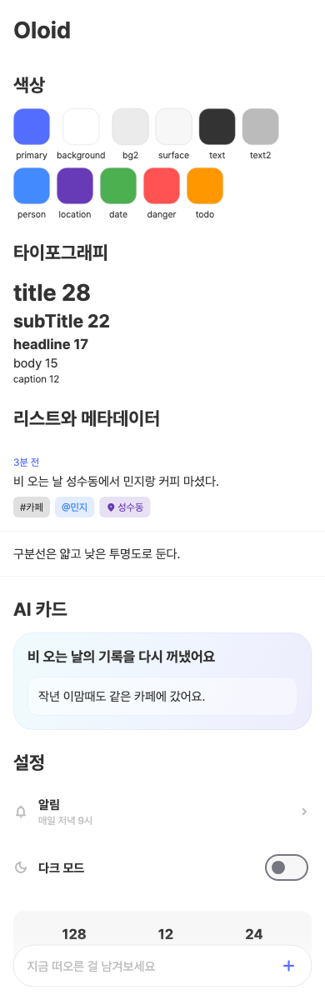
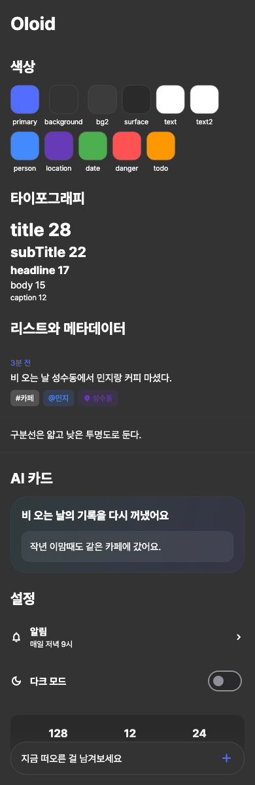

# Oloid

> 올로이드는 두 원을 직각으로 엇갈려 감싼 입체다. 굴러가는 동안 표면의 모든 점이
> 한 번씩 바닥에 닿고, 무게중심은 거의 흔들리지 않는다.
>
> 이 패키지도 그렇게 쓰이길 바란다. 앱마다 굴러가는 방향(브랜드 색, 기능)은 달라도
> 모두 같은 바닥(토큰과 원칙)을 딛고, 중심(조용한 캔버스, 의미 있는 색, 본문이
> 주인공)은 흔들리지 않는다.

LuceForge 앱 공용 Flutter 디자인 시스템. memoaid의 색상·타이포·radius·간격 토큰과 반복 UI 패턴(시트, 리스트 row, 메타데이터 chip, AI 카드, 하단 플로팅 바, 토스트)을 패키지로 묶었다.

- 디자인 의도와 원칙의 원본: `memoaid/Design.md`
- 이 패키지는 그 의도를 코드로 옮긴 구현이다. 토큰 값을 바꿀 때는 Design.md와 함께 바꾼다.

| 라이트 | 다크 |
| --- | --- |
|  |  |

## 1. 앱에 추가하기

### 배포용: git 의존성 (권장)

앱의 `pubspec.yaml`:

```yaml
dependencies:
  oloid:
    git:
      url: https://github.com/qqwert1122/oloid.git
      ref: v0.2.0   # 태그로 고정한다. main을 쓰면 빌드마다 결과가 달라질 수 있다.
```

Xcode Cloud와 GitHub Actions는 앱 저장소만 clone하므로 `path:` 의존성으로는 CI 빌드가 깨진다. CI에서 받을 수 있게 반드시 git 의존성으로 둔다.

> 저장소를 private으로 두면 CI가 이 저장소를 clone할 권한이 따로 필요하다.
> 공개 저장소가 가장 단순하다(토큰과 위젯만 있고 비밀 값은 없다).

### 로컬 개발: pubspec_overrides.yaml

디자인 시스템을 고치면서 앱에서 바로 보고 싶을 때는 앱 루트에 `pubspec_overrides.yaml`을 만든다.

```yaml
dependency_overrides:
  oloid:
    path: ../oloid
```

그리고 앱의 `.gitignore`에 `pubspec_overrides.yaml`을 추가한다. 로컬에서는 path를, CI에서는 git 태그를 쓰게 된다.

## 2. 테마 연결

```dart
import 'package:oloid/oloid.dart';

MaterialApp(
  theme: OloidTheme.light(),
  darkTheme: OloidTheme.dark(),
  themeMode: ThemeMode.system, // 앱 설정값을 넘겨도 된다
  home: const HomePage(),
);
```

이것만으로 Pretendard 폰트, Material 3, 배경색, 하단 네비게이션, 진행 표시, 버튼, 입력창 스타일이 적용된다. **폰트 파일을 앱에 따로 넣을 필요가 없다**(패키지에 번들됨).

### 앱마다 브랜드 색 바꾸기

구조(배경·텍스트·간격)는 공유하고 주 액션 색만 바꾼다.

```dart
theme: OloidTheme.light(primary: const Color(0xFF00A86B)),
darkTheme: OloidTheme.dark(primary: const Color(0xFF00A86B)),
```

토큰을 더 바꾸려면:

```dart
theme: OloidTheme.fromColors(
  OloidColors.light().copyWith(todo: Colors.teal),
  Brightness.light,
),
```

## 3. 토큰 쓰기

```dart
final c = context.oloid;            // 현재 테마(라이트/다크)의 OloidColors

Text('제목', style: OloidTypography.title.copyWith(color: c.textPrimary));
Text('3분 전', style: OloidTypography.caption.copyWith(color: c.primary));

Container(
  padding: const EdgeInsets.all(OloidSpacing.row),
  decoration: BoxDecoration(
    color: c.surface,
    borderRadius: BorderRadius.circular(OloidRadius.card),
  ),
);
```

| 그룹 | 클래스 | 값 |
| --- | --- | --- |
| 색 | `OloidColors` (`context.oloid`) | primary, background, backgroundSecondary, surface, textPrimary, textSecondary, border, shadow, divider · 의미색 person, location, date, favorite, danger, todo, positive, warning · AI 전용 aiGradient*, aiBorder, aiInset |
| 글자 | `OloidTypography` | largeTitle 34, title 28, subTitle 22, headline 17, body 15, bodyStrong 15/600, input 16, caption 12, captionStrong 12/600, tab 16, button 15 · `textTheme`(Material 역할 매핑) · 자간은 모두 0 |
| radius | `OloidRadius` | xs 4, chip 6, control 8, card 12, button 16, sheet 20, pill 24, dialog 32 |
| 간격 | `OloidSpacing` | s1 4 … s8 32, screen 16, row 16, sheet 24, indent 24, pageTitle, chip |
| 아이콘 | `OloidIconSize` | metadata 12, row 16, nav 18, picker 24 |
| 모션 | `OloidMotion` | fast 250ms, standard 300ms, number 1000ms, toast 2s |
| 그림자 | `OloidShadows` | floating(colors), dialog |

## 4. 컴포넌트

| 컴포넌트 | 언제 쓰나 |
| --- | --- |
| `OloidPageTitle('기록')` | 화면 제목. 무거운 AppBar 대신 |
| `OloidPinnedAppBar(title:)` | 스크롤 후에도 남는 fade형 헤더 |
| `OloidListRow(child:, onTap:)` | 기록성 콘텐츠. 카드 대신 row + 얇은 구분선 |
| `OloidChip.tag('카페')` / `.person('민지')` / `.location('성수동')` / `OloidChip(label:, color:)` | 메타데이터 |
| `OloidPanel(child:)` | stat card 같은 독립된 정보 덩어리 |
| `OloidSectionHeader('알림')`, `OloidSettingRow(icon:, title:, subtitle:, trailing:, onTap:, padding:)` | 설정 화면. 스위치 줄은 `trailing: Switch.adaptive(...)`, 패널 안에서는 `padding`의 좌우를 0으로 |
| `OloidButton(label:, onPressed:, variant:, icon:, dense:)` | primary / tonal(옅은 브랜드색, 보조 액션) / secondary / destructive. `dense`는 패널 안 40px 높이 |
| `OloidConfirmSheet.show(...)` → `bool?` | 삭제·수정 전 확인 |
| `OloidInfoSheet.show(...)` | 안내 + 확인 버튼 |
| `showOloidBottomSheet(context, builder:, heightFactor: 0.7)` | 작성·편집·상세 sheet |
| `OloidFloatingBar(placeholder:, onTap:)` | 하단 입력/검색 진입점. `Positioned(left: 0, right: 0, bottom: 0)` 안에 둔다 |
| `OloidAiCard(child:)`, `OloidAiDecoration.card/inset(context)` | AI 보조 surface 전용 |
| `OloidToast.success/error/warning/info(context, '저장했어요')` | 짧은 상태 메시지. SnackBar 대신 |
| `OloidEmptyState(message:)` | 빈 상태 |
| `OloidGallery()` | 카탈로그. 디버그 메뉴에 붙여 현재 테마로 확인 |

```dart
final ok = await OloidConfirmSheet.show(
  context,
  title: '기록을 삭제할까요?',
  content: '삭제한 기록은 되돌릴 수 없어요.',
  confirmText: '삭제',
  destructive: true,
);
if (ok == true) OloidToast.success(context, '삭제했어요');
```

`OloidToast`는 앱 쪽 wrapper(`ToastificationWrapper` 등)가 필요 없다.

## 5. 기존 앱 옮기기

이미 `AppColors`/`AppTextStyles`가 있는 앱(memoaid, 100-timer, assetorbit 등)은 한 번에 갈아엎지 않고 다음 순서로 옮긴다.

1. pubspec에 의존성 추가, `MaterialApp`의 theme을 `OloidTheme`로 교체.
2. 기존 `AppColors`의 getter가 `OloidColors`를 가리키게 바꿔 호출부는 그대로 둔다. 전역 dark 플래그 대신 `context.oloid`를 쓰는 게 목표다.
3. 화면을 고칠 때마다 `AppColors.x` → `context.oloid.x`, `AppTextStyles.x` → `OloidTypography.x`, 공용 시트·토스트를 `Ds*` 컴포넌트로 바꾼다.
4. 다 옮기면 앱의 `assets/fonts/Pretendard-*`와 pubspec `fonts:` 항목을 지운다.

| memoaid | oloid |
| --- | --- |
| `AppColors.primaryColor` | `context.oloid.primary` |
| `AppColors.background` / `backgroundSecondary` / `surface` | `context.oloid.background` / `backgroundSecondary` / `surface` |
| `AppColors.textPrimary` / `textSecondary` / `border` / `shadow` | `context.oloid.textPrimary` / … |
| `AppTextStyles.body` 등 | `OloidTypography.body` 등 |
| `AiCardStyle.decoration()` / `insetDecoration()` | `OloidAiDecoration.card(context)` / `inset(context)` |
| `ConfirmBottomSheet.show(confirmColor: Colors.redAccent)` | `OloidConfirmSheet.show(destructive: true)` |
| `InfoBottomSheet.show(contents:)` | `OloidInfoSheet.show(bullets:)` |
| `AppToast.success` | `OloidToast.success` |
| `DragHandle`, `PinnedAppBar` | `OloidDragHandle`, `OloidPinnedAppBar` |

`fontFamily: 'Pretendard'`로 직접 지정한 곳은 앱 폰트를 지우기 전에 `OloidTypography.fontFamily`로 바꿔야 한다.

## 6. 디자인 시스템 고치기

```bash
flutter analyze
flutter test --exclude-tags golden
flutter test --tags golden --update-goldens   # 모양을 바꿨다면 카탈로그 스크린샷 갱신
```

릴리스는 `pubspec.yaml`의 version과 `CHANGELOG.md`를 올리고 같은 이름의 태그(`v0.2.0`)를 push한다. 각 앱은 `ref`를 새 태그로 바꾼 뒤 `flutter pub upgrade oloid`을 실행한다. 토큰 이름을 바꾸거나 지우는 변경은 minor 버전을 올리고 CHANGELOG에 옮기는 방법을 적는다.

## 원칙 요약

- 캔버스는 조용하게: 카드보다 row, 그림자는 떠 있는 것에만.
- 색은 의미가 있을 때만: 주 액션·선택·메타데이터 타입·상태.
- 메타데이터는 작게: chip, 아이콘, 낮은 투명도.
- AI gradient는 AI 보조 surface에만.
- 짧은 메시지는 `OloidToast`, 확인은 `OloidConfirmSheet`, 편집은 bottom sheet.
- 문구는 `~해요` 톤.
